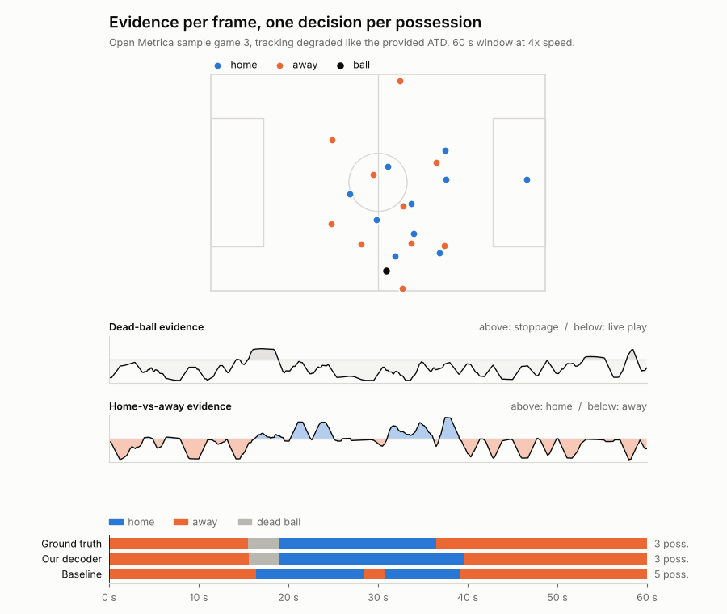
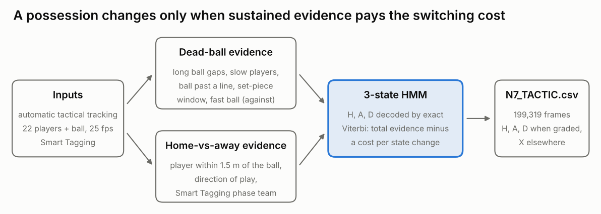
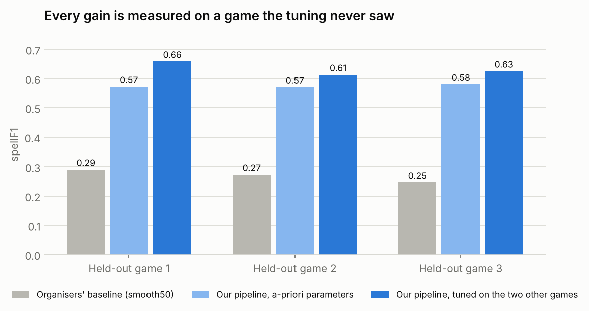
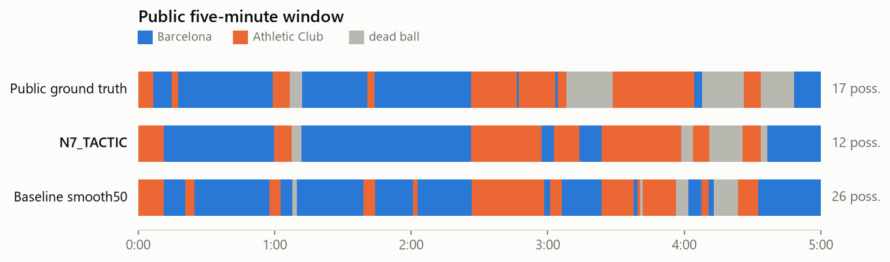

# Ball Possession from Automatic Tracking

**Technical report | More than a Hack 2027 | Phase 1 | Team N7_TACTIC**



<sub>Animation drawn on an open Metrica sample game with degraded tracking, so that no competition
data is published. Regenerate with `python tools/make_method_gif.py`.</sub>

## Abstract

We label every frame of Barcelona vs Athletic Club (LaLiga, 24 August 2024) as home possession
`H`, away possession `A` or dead ball `D`, from the automatic tactical tracking and the Smart
Tagging alone. Two per-frame evidence signals, one for stoppages and one for which team controls
the ball, are decoded by a three-state hidden Markov model with exact Viterbi, so that a
possession only changes when sustained evidence pays a switching cost. Every parameter was tuned on
**three other matches** (Metrica's open sample games, tracking degraded to resemble the provided
one, labels derived from their event data with the challenge's "controlled possession" rule).
On those matches, leave-one-game-out spellF1 is **0.633**, against **0.27** for the organisers'
baseline. On the public five-minute window, which was never used for tuning, the submission
scores **0.469 spellF1** and **0.722 macroF1**, against 0.424 and 0.581 for the strongest listed
baseline. Both are development checks, not estimates of the full-match score.

This README is also the technical document of the submission (`N7_TACTIC.md` is the same file).

## 1. Task and approach

The output has one label per frame of the tactical video, **199,319 frames at 25 fps**: `H`, `A`,
`D` on the graded halves and `X` elsewhere. The ranking metric, spellF1, matches whole possessions
by temporal intersection-over-union, so a single wrong frame inside a long possession splits it in
two and adds a false one. We therefore treat the task as **segmentation**, not as frame
classification.



The decoder is the one-dimensional analogue of a Potts, or total-variation, denoiser: the output
is piecewise constant, boundaries stay sharp, and each jump has a price. A defender brushing past
the ball produces a short burst of contrary evidence that cannot pay the switching cost; a real
interception produces sustained evidence that can. A sliding majority vote, as in the baseline,
only sees duration: it either keeps flicker (narrow window) or swallows short possessions (wide
window), and it almost never produces a dead ball.

## 2. What the provided tracking contains

Measured with the scripts in `diagnostics/`, which print aggregates only and never read labels.

| Finding | Consequence |
| --- | --- |
| No ball-alive/dead channel and no owning-team channel in the automatic tracking (`ball_state`, `ball_owning_team` empty) | both must be inferred |
| Ball missing on 41% of graded frames, almost only in long gaps: 85% of missing frames sit in gaps over 10 s, none between 1 and 3 s | short occlusions are already interpolated by the tracker; long gaps need team-level cues |
| Ball speed field filled on fewer than 15% of ball frames, with implausibly low values; player speeds are in m/s despite the `speed_kph` channel name | ball speed is recomputed from smoothed positions |
| Ball-to-nearest-player distance: median 1.9 m, 29% of frames under 1 m | control is plausible within about 1.5 m, not "at the feet" |
| Around tagged set pieces the ball is missing 69% of the time (42% at random instants) and collective speed drops from 1.4 to 0.95 m/s; tags open about 3.5 s before the restart | stoppage cues and a restart anchor |
| Ball positions up to 23 m past the touchline | spare balls or tracker confusion: treated as "no ball" |
| Smart Tagging team tags agree with the team in clear control 71% (possession phases) and 81% (defending phases) of the time | a useful but weak prior |

## 3. Data and asset use

| Asset | Use |
| --- | --- |
| Provided tactical tracking (players, ball, metadata) | the only geometric input |
| Provided Smart Tagging | set-piece starts (restart anchor) and phase Team tags (weak ownership prior) |
| Provided videos, broadcast tracking, homographies | not used |
| Public five-minute ground truth | format and alignment check, figure in section 7; never used for tuning |
| Organisers' baseline files | comparison only |
| Metrica open sample games 1, 2, 3 | tuning and validation (section 6) |

No labels of any kind were produced by hand, on any match.

## 4. Per-frame evidence

All values are in `solution/config.py`, each with its justification. Evidence is in log-odds per
frame; the decoder sums it over time, so a value of 1 held for one second weighs 25.

**Dead-ball evidence** (positive means stoppage):

| Term | Value |
| --- | --- |
| prior | -0.5 |
| ball missing for at least 0.5 s / at least 20 s | +1.0 / +0.25 more |
| collective player speed, smoothed over 1 s | 0.5 x clip((1.8 - v) / 0.5, -2, 2) |
| ball at least 0.5 m past a line for at least 0.4 s | +2.0 |
| inside a set-piece window: from 3 s before the tag to the restart kick (ball faster than 3 m/s, fallback 5 s) | +1.0 |
| ball moving faster than 6 m/s | -2.5 |

**Home-vs-away evidence** (positive means home):

| Term | Value |
| --- | --- |
| distance advantage `d_away - d_home` of the nearest player of each team, clip(advantage / 0.5 m, -2, 2) | weight 1.0 if the nearest player is within 1.5 m, 0.4 within 3 m, 0 beyond |
| same term when the ball travels faster than 8 m/s | ignored: a ball passing a player is not a change of possession |
| direction of play: speed of the players' centroid towards the away goal (m/s, attack direction inferred per half from team centroids) | 0.1 |
| where the play is, from -1 (home goal) to +1 (away goal) | 0.1 |
| Smart Tagging phase naming the team in possession (Build Up, Progression, ...) or out of it (Defending in ..., Defensive Transition) | 0.2 |

The direction-of-play term matters most during long ball gaps: when a team wins the ball, the
whole block turns towards the other goal, while proximity says nothing because the ball is not
tracked.

## 5. Decoder

Per-frame scores, with `e_dead` and `e_own` the two evidence values:

```text
H:  +0.5 x e_own
A:  -0.5 x e_own
D:  e_dead
```

Viterbi maximises the sum of these scores minus a cost for every state change, independently in
each half:

| From \ To | H | A | D |
| --- | ---: | ---: | ---: |
| H | 0 | 28 | 24 |
| A | 28 | 0 | 24 |
| D | 16 | 16 | 0 |

Implemented possession rules:

| Situation | Treatment |
| --- | --- |
| Controlled possession | sustained proximity evidence pays the 28-point switching cost |
| Passes, loose and contested balls | no evidence while the ball travels: the decoder keeps the previous owner |
| Touches, deflections, aerial duels | too brief to pay the switching cost: no change |
| Stoppages and restarts | dead until the restart kick, then whichever team controls the ball |
| Half boundaries | each half decoded separately; frames outside the graded halves are `X` |

There is no frame-specific rule and no override tied to observed moments of the match.

## 6. Validation on other matches

**Labels.** Metrica's open sample games come with human-coded event data. Our code
(`extval/opendata.py`) turns them into frame labels: `D` from the moment play stops (ball out,
foul, offside, referee stop) to the next on-ball event, otherwise the team of the last
possession-defining event. A turnover then counts only if the new team keeps the ball for at
least 3 s or completes at least 3 passes, which is the challenge's notion of controlled
possession. This gives about 230 possessions per match with a mean of 15 s, in line with the
organisers' description of their ground truth (mean 14.2 s on the public window).

**Degradation.** Open tracking is clean, ours is not, so `extval/degrade.py` degrades it to match
the statistics of section 2: long ball gaps during play and stoppages, interpolated short
occlusions, a slowly varying 0.8 m ball position error (fitted to the ball-to-player distance
distribution), about 20.5 of 22 players visible, spare-ball detections, and a simulated Smart
Tagging. Four scenarios bracket what cannot be measured without labels, such as how strongly ball
loss is tied to stoppages.

**Check of the bench.** The organisers' baseline scores 0.247 spellF1 on held-out game 3 of the
bench and 0.2433 on the real full match, so the bench reproduces the real difficulty.

**Tuning.** Coordinate descent over 25 parameters, objective the official spellF1 averaged over
scenarios, scored with the unmodified `evaluation/possession_metrics.py`. Each game in turn is
held out:



The final parameters are tuned on all three games (bench spellF1 0.655). Logistic models learned
on about 60 binned features were also tried as emissions (`solution/model.py`,
`extval/train.py`): 0.561 against 0.581 for the hand-made evidence on a held-out game, before the
direction-of-play term was added. With labels from three games and a simulated degradation, more
free parameters meant more room to learn the simulator rather than the football, so the simpler
evidence was kept.

**Training data, as required by SUBMISSION.md:**

| Dataset | Source | Labelled by | Amount |
| --- | --- | --- | --- |
| Metrica Sports sample games 1, 2, 3 | [github.com/metrica-sports/sample-data](https://github.com/metrica-sports/sample-data) | event data coded by Metrica Sports; frame labels derived by our code | 3 matches, 7,300 events, about 283 graded minutes |

## 7. Results on the public window



Same 7,500 frames and 17 reference possessions for every row:

| Submission | spellF1 | macroF1 | Possessions |
| --- | ---: | ---: | ---: |
| **N7_TACTIC** | **0.469** | **0.722** | **12** |
| Baseline smooth125 | 0.424 | 0.581 | 16 |
| Baseline smooth50 | 0.326 | 0.621 | 26 |
| Baseline smooth25 | 0.287 | 0.620 | 36 |
| Baseline raw | 0.038 | 0.597 | 131 |

On the full match the submission reports 232 possessions with a mean of 15.7 s. With 17
possessions, one possession moves spellF1 by about 0.06 on this window, which is why it was used
to catch bugs and never to choose between versions.

## 8. Limitations

- The bench is a simulation: properties of the automatic tracking that cannot be measured without
  labels are bracketed by scenarios, not known.
- Event-derived labels approximate, but are not, the corrected-tracking definition of the ground
  truth.
- The decoder still under-segments slightly: 12 possessions for 17 on the public window, about 200
  for 230 to 250 per bench match.
- Boundaries are not re-aligned to the exact contact frame.

## 9. Reproduction

Python 3.11, from the repository root:

```bash
python -m venv .venv
.venv\Scripts\activate                      # Windows; source .venv/bin/activate elsewhere
pip install -r requirements.txt             # numpy 2.2.6, pandas 2.2.3
# unpack the official data bundle into data/ (see DATA.md), or set MTAH_DATA_DIR
python make_submission.py                   # writes N7_TACTIC.csv
python evaluation/validate_submission.py N7_TACTIC.csv
```

The pipeline is deterministic: two runs produce byte-identical files. The parsed tracking is
cached in `cache/`, which is gitignored like `data/`.

Validation, tuning and figures (needs `matplotlib` for the figures):

```bash
git clone https://github.com/metrica-sports/sample-data opendata/sample-data
python -m extval.bench                      # baseline vs our pipeline on the degraded open games
python -m extval.tune --holdout 3           # tune on games 1 and 2, score game 3
python -m extval.tune                       # tune on all three: values in solution/config.py
python tools/make_method_gif.py             # docs/assets/method.gif
python tools/make_figures.py                # docs/assets/pipeline.png, bench.png
python tools/plot_public_window.py          # docs/assets/public_window.png
```

## 10. Repository layout

| Path | Content |
| --- | --- |
| `solution/` | the method: data loading, evidence, decoder, parameters (numpy only) |
| `make_submission.py` | provided data in, `N7_TACTIC.csv` out |
| `extval/` | validation bench on the open games: labels, degradation, tuning |
| `diagnostics/` | label-free statistics of the provided data |
| `tools/` | figures and animation of this README |
| `docs/assets/` | the figures |
| `evaluation/`, `starter/`, `*.md` in capitals | the official starter repository, unchanged |

## Licence and credits

Code under the MIT licence of the official starter repository (`LICENSE`). Match data of the
challenge are under the competition terms and are not included. Validation data and the animation
use the [Metrica Sports sample data](https://github.com/metrica-sports/sample-data), credited to
Metrica Sports.
