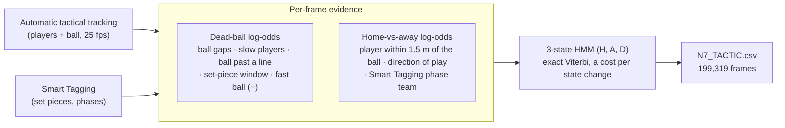
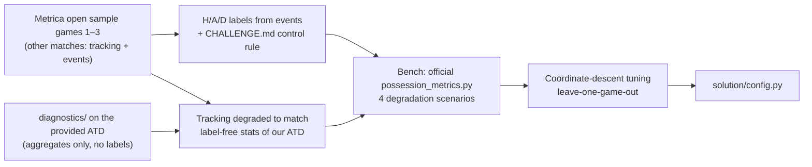

# N7_TACTIC — Ball possession, More than a Hack 2027 (Phase 1)

Our submission for [More than a Hack 2027](CHALLENGE.md) (Metrica Sports × FC Barcelona Innovation
Hub × Mobile World Capital Barcelona): for every frame of Barcelona–Athletic, who has the ball —
`H`, `A`, or `D` (dead ball).

This repository is a copy of the [official starter repository](https://github.com/metrica-sports/more-than-a-hack-2027)
(MIT, see `LICENSE`) plus our solution. The official task documents (`CHALLENGE.md`, `DATA.md`,
`EVALUATION.md`, `SUBMISSION.md`, `RULES.md`, `FAQ.md`) are kept unchanged.
Technical document: [`N7_TACTIC.md`](N7_TACTIC.md).

## Method at a glance



The ranking metric (spellF1) scores whole possessions, so a single flicker splits a true
possession and invents a false one. The decoder therefore only changes state when the evidence
for it is sustained: a defender brushing past the ball does not pay the switching cost; a genuine
interception does.

## How the parameters were chosen



No parameter was fitted to the provided game's labels; the public 5-minute window is used only to
check alignment and format. Leave-one-game-out spellF1 on the bench: **0.633** (untuned 0.575,
organisers' baseline ≈0.25 — 0.247 on the bench vs 0.2433 on the real match).

## Repository layout

```
solution/          the method (numpy only)
  config.py        every parameter and where its value comes from
  data.py          reads the ATD (raw text + XML) and the Smart Tagging
  evidence.py      per-frame dead-ball and home-vs-away evidence
  features.py      attack direction per half (+ feature matrix of the learned variant)
  decode.py        3-state HMM, exact Viterbi
  pipeline.py      the whole method as one function, independent of the match
  model.py         learned-emission variant (evaluated, not used)
make_submission.py provided data in -> N7_TACTIC.csv out
extval/            validation bench on Metrica's open sample games
diagnostics/       label-free diagnostics of the provided data (aggregates only)
```

## Reproduce the submission

```bash
pip install -r requirements.txt
# official data bundle unpacked in ./data (see DATA.md), or set MTAH_DATA_DIR
python make_submission.py
python evaluation/validate_submission.py N7_TACTIC.csv
```

Deterministic: no randomness anywhere, so two runs produce byte-identical files. The parsed
tracking is cached in `cache/` (gitignored, like `data/`).

## Reproduce the validation and tuning

```bash
git clone https://github.com/metrica-sports/sample-data opendata/sample-data
python -m extval.bench                 # baseline vs our pipeline on the degraded open games
python -m extval.tune --holdout 3      # tune on games 1-2, score game 3
python -m extval.tune                  # tune on all three -> values in solution/config.py
```

The degradation is seeded, so the bench is reproducible too.

## Diagnostics of the provided data

```bash
python diagnostics/diag_step0.py       # structure: channels, fields, % NaN
python diagnostics/diag_step1.py       # speed units, ball gaps, out-of-bounds, collective speed
python diagnostics/diag_step2.py       # cues around Smart Tagging restarts vs random instants
python diagnostics/diag_step3.py       # statistics used to calibrate the simulator
```

They print aggregates only (percentiles, rates, counts) and never read the ground truth.
